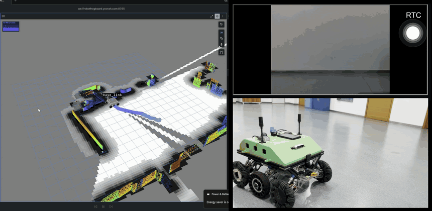
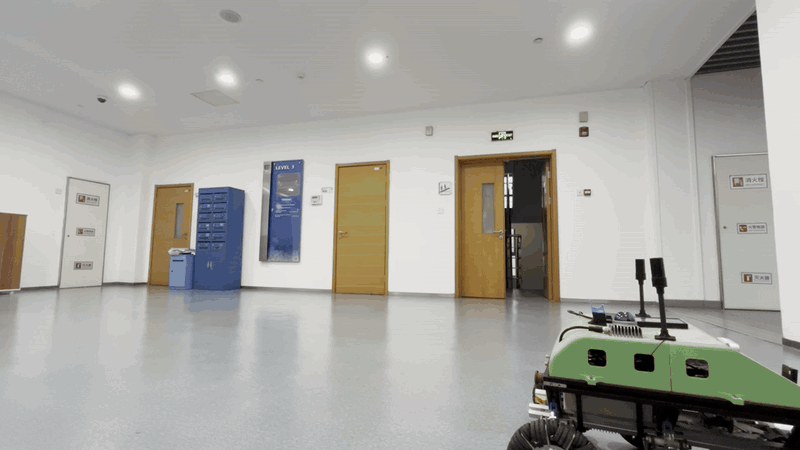

# Frogbot: Autonomous Vehicle

ROS 2 Humble repository for the XJTLU autonomous vehicle platform.



- Indoor & outdoor navigation
  - Indoor stack: FAST-LIO2 + PGO + Nav2 MPPI
  - Outdoor uses RTK GNSS signal
- [Remote Teleoperation: Frogboard](#remote-teleoperation--video-streaming-frogboard)
- [STM32 lower-controller firmware](https://github.com/yoon-zh/frogbot-stm32)


## Current State

> [!IMPORTANT]
> The current robot setup does not detect glass obstacles such as window walls. This is currently being fixed.

> [!NOTE]
> This project is in active development. The main branch contains the most recent working state of the robot.

- The robot uses a Jetson Orin NX running Ubuntu 22.04, STM32 lower controller, and ROS 2 Humble
- Currently working on autonomous indoor exploration: Survey mode
- Verified indoor navigation stack: FAST-LIO2 + PGO + Nav2 MPPI, launched through `make launch-indoor-nav`.
- Verified outdoor GNSS (RTK) path: GPS Corridor, launched through `make launch-corridor`.
- Remote headless teleoperation: FrogBoard mobile web application over WebSockets and WebRTC video streaming from the RealSense camera.
- Session logs are created by `scripts/launch_with_logs.sh`.




## Hardware And Software Stack

| Layer | Current implementation |
|------|------------------------|
| Compute | Jetson Orin NX, Ubuntu 22.04, ROS 2 Humble |
| LiDAR / IMU | Livox MID360 and WIT/BMI088-related IMU support |
| Camera / Video Stream | Intel RealSense D455f RGB stream via go2rtc (WebRTC H.264 @ 640x480 30fps) |
| GNSS | T-RTK UM982 Dual Antenna Mobile Kit |
| Lower controller | STM32 RM C Board via [Git submodule](https://github.com/yoon-zh/frogbot-stm32) over serial / PTY proxy bridge |
| Remote Teleoperation | FrogBoard mobile web app over secure WebSocket + PTY command arbitration |
| Localization | FAST-LIO2 + PGO |
| Navigation | Nav2 MPPI with mode-specific bringup and behavior trees |
| Runtime data | `runtime-data/` inside the workspace, not pushed to Git |

## Quick Start

Run these commands on the Jetson workspace:

```bash
make setup
make build
source /opt/ros/humble/setup.bash
source install/setup.bash
bash scripts/init_runtime_data.sh
```

`make setup` automatically imports [third-party dependencies](dependencies.repos), initializes [Git submodules](https://github.com/yoon-zh/frogbot-stm32), resolves rosdep dependencies, and installs required Python packages: `websockets`, `geojson`, `geopy`, `matplotlib`.

Colcon build commands must keep `--parallel-workers 1` on Jetson because of memory limits. The `Makefile` already follows that rule.

## Operating Modes

```bash
make launch-slam         # FAST-LIO2 + PGO + SLAM Toolbox mapping workflow
make launch-explore      # FAST-LIO2 + PGO + Nav2 local navigation
make launch-indoor-nav   # Explore stack without GNSS, for RViz click-to-go testing
make launch-corridor     # GPS Corridor runtime on the MPPI baseline
make launch-travel       # Static-map navigation workflow, currently paused
make launch-explore-gps  # Explore mode with GNSS bringup and PGO GPS factor
make launch-nav-gps      # Scene-bundle + route-graph GPS goal navigation workflow
make launch-rtk-basic    # RTK signal testing with CORS account
make launch-tightly-coupled # Tightly-coupled system using FGO, currently in validation
make launch-survey       # Autonomous exploration for indoor mapping and database relocalization
```

All `make launch-*` targets go through [scripts/launch_with_logs.sh](scripts/launch_with_logs.sh), which creates a per-session directory under `runtime-data/logs/`.

Stop runtime processes with:

```bash
make kill
```

Force-disconnect all FrogBoard mobile devices with:

```bash
make kill-phones
```

## Remote Teleoperation & Video Streaming (FrogBoard)

The robot supports headless field operation and remote manual driving from mobile phones or laptops:

- FrogBoard Server: Asynchronous WebSocket server (TLS/WSS on port 9090) interfacing with [frogboard.yoonzh.com](https://frogboard.yoonzh.com/)
- WebRTC Camera Stream using [go2rtc](https://github.com/AlexxIT/go2rtc) on port 1985 (TLS) and 8555 (WebRTC)
- Both services run as systemd daemons on boot
- Full operational procedures and disconnection options are documented in [`docs-EN/commands.md#frogboard-mobile-app-controlling`](docs-EN/commands.md#frogboard-mobile-app-controlling) and [`scripts/camera_stream/README.md`](scripts/camera_stream/README.md)

## Repository Layout

```text
src/
  bringup/          Launch files, Nav2 configs, maps, behavior trees, RViz assets
  sensor_drivers/   Livox, WIT IMU, GNSS, serial, and lower-controller interfaces
  perception/       FAST-LIO2, PGO, point cloud conversion, occupancy-grid helpers
  planning/         GNSS global planning and coordinate transforms
  navigation/       Waypoint tools and GPS route dispatch
  firmware/         STM32 RM C Board lower-controller git submodule

docs-CN/            Active Chinese documentation
docs-EN/            Active English documentation
scripts/
  camera_stream/    go2rtc WebRTC camera configuration and systemd service
  frogboard_server/ FrogBoard WebSocket teleoperation server and serial PTY proxy
  data_collection/  Bag and performance recording utilities
dependencies.repos  vcs import manifest for external dependencies
```

## Build And Test

Common build targets:

```bash
make build
make build-bringup
make build-fastlio2
make build-sensor
make build-perception
make build-planning
make build-navigation
make build-firmware
make test
```

Running `make test` executes both ROS 2 colcon test suites and the Frogboard protocol unit tests.

Source after every build:

```bash
source /opt/ros/humble/setup.bash
source install/setup.bash
```

Package-level builds follow this form:

```bash
colcon build --packages-select <pkg> --symlink-install --parallel-workers 1
source /opt/ros/humble/setup.bash
source install/setup.bash
```

## Runtime Data

In the robot, the active runtime root is: `runtime-data/`. Inside:

- `logs/` launch session logs, rosbag output, console logs, and custom node logs.
- `gnss/` GNSS route files, startup repeatability data, and GNSS calibration artifacts.
- `maps/` map and route inputs used by mapping and GNSS planning tools.
- `config/` runtime logging switches and local operational state.

## Documentation

- Chinese documentation index: [`docs-CN/index.md`](docs-CN/index.md)
- English documentation index: [`docs-EN/index.md`](docs-EN/index.md)
- System architecture: [`docs-EN/architecture.md`](docs-EN/architecture.md)
- Command reference: [`docs-EN/commands.md`](docs-EN/commands.md)
- FrogBoard mobile controlling: [`docs-EN/commands.md#frogboard-mobile-app-controlling`](docs-EN/commands.md#frogboard-mobile-app-controlling)
- WebRTC camera streaming guide: [`scripts/camera_stream/README.md`](scripts/camera_stream/README.md)
- Known issues: [`docs-EN/known_issues.md`](docs-EN/known_issues.md)
- Contributing guide (CN): [`CONTRIBUTING.md`](CONTRIBUTING.md)
- Contributing guide (EN): [`CONTRIBUTING-EN.md`](CONTRIBUTING-EN.md)
- STM32 firmware submodule: [`src/firmware/frogbot-stm32`](src/firmware/frogbot-stm32)

The `docs-CN/` and `docs-EN/` trees are maintained as paired documentation. Update both whenever submitting changes.

## Contribution And Safety Boundaries

- Do not modify tuned YAML parameters without documenting why
- Do not modify imported upstream/vendor code casually
- Keep Jetson builds at `--parallel-workers 1`
- Follow [`CONTRIBUTING.md`](CONTRIBUTING.md) before opening or merging changes
