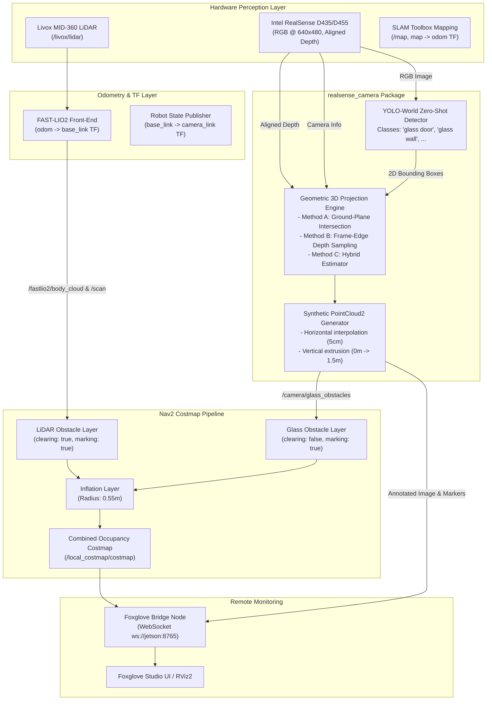

# RealSense Glass Obstacle Detection & Nav2 Costmap Guide

## 1. Problem Formulation & Architecture

### The Physical Challenge: Why IR Depth Sensors Miss Glass
RealSense cameras (D435, D455, D455f) and LiDAR sensors rely on infrared light (~850 nm to ~905 nm). Clean architectural glass is optically transparent to near-infrared light and exhibits specular reflectance:
- Active infrared beams and laser pulses pass straight through the glass pane and measure whatever objects exist *behind* the glass.
- Rays striking the glass at non-normal angles scatter away from the camera/sensor, yielding null or invalid depth readings.
- Consequently, raw point clouds from both LiDAR and depth cameras treat glass doors, partitions, and floor-to-ceiling windows as completely empty, traversable space.

### The Solution: Zero-Shot Vision + Geometric Extrusion
Instead of training a custom CNN from scratch, we employ YOLO-World, an open-vocabulary pre-trained zero-shot detector. It accepts arbitrary text prompts (e.g. `"glass door"`, `"glass wall"`, `"window"`, `"door frame"`) and detects them immediately.

Once a 2D bounding box is detected, its 3D location and physical extent are computed using geometric ground-plane projection and frame-edge depth sampling, and extruded into a dense synthetic 3D point cloud (`sensor_msgs/msg/PointCloud2`) published to Nav2.



---

## 2. Mathematical Principles: Determining 3D Glass Coordinates

### Method A: Ground-Plane Ray Intersection (Frameless Glass Walls)
Glass walls and floor-to-ceiling doors meet the floor flush along the bottom edge of their bounding box ($v_{\max}$). With the camera mounted at known height $h$ and pitch angle $\theta$ (tilted down is positive):

$$\vec{r}_{\text{opt}} = \begin{pmatrix} \frac{u - c_x}{f_x} \\ \frac{v_{\max} - c_y}{f_y} \\ 1 \end{pmatrix}$$

The downward component of the ray relative to the ground normal is:
$$d_y = \sin(\theta) + \frac{v_{\max} - c_y}{f_y}\cos(\theta)$$

If $d_y > 0$ (the ray points downward below the horizon), the exact 3D distance $Z_{\text{opt}}$ along the optical axis is:
$$Z_{\text{opt}} = \frac{h}{\sin(\theta) + \frac{v_{\max} - c_y}{f_y}\cos(\theta)}$$

$$X_{\text{opt}} = \frac{u - c_x}{f_x} \cdot Z_{\text{opt}}, \quad Y_{\text{opt}} = \frac{v_{\max} - c_y}{f_y} \cdot Z_{\text{opt}}$$

### Method B: Frame-Edge Depth Sampling (Framed Glass Doors)
Commercial glass doors, partitions, and windows typically have an opaque aluminum frame, baseboard, or frosted kick-plate.
- We sample RealSense depth values strictly within a narrow strip of rows $[v_{\max} - \Delta v, v_{\max}]$ (where $\Delta v \approx 5\text{--}10\text{ px}$).
- Filter valid non-zero depth readings within $[0.2\text{ m}, 8.0\text{ m}]$.
- Compute the median depth $Z_{\text{frame}}$ for the left side ($u_{\min}$) and right side ($u_{\max}$).
- Project using the pinhole camera model.

### Method C: Hybrid Mode (Default)
1. Sample frame-edge depth (Method B).
2. If at least 5 valid depth readings exist $\implies$ use measured frame depth.
3. If depth readings are zero or null (frameless transparent glass) $\implies$ fall back to ground-plane intersection (Method A).

### Synthetic Wall Extrusion
For detected bottom endpoints $\mathbf{P}_L$ and $\mathbf{P}_R$ in the robot base frame (`base_link`):
1. Horizontal Interpolation: Sample along $\overline{\mathbf{P}_L \mathbf{P}_R}$ with resolution $\Delta s = 0.05\text{ m}$ (5 cm).
2. Vertical Extrusion: For each ground sample, extrude points vertically from ground level ($Z = 0.0\text{ m}$) up to wall height $H = 1.5\text{ m}$ at $\Delta z = 0.05\text{ m}$ intervals.
3. Publish as standard `sensor_msgs/msg/PointCloud2`.


## 3. Hardware Setup on the Vehicle

### 3.1 Physical Mounting
1. Mounting Location: Mount the RealSense camera facing forward on the vehicle's upper mast or front bracket (aligned with vehicle longitudinal center axis).
2. Measure Height ($h$): Measure the vertical distance from the ground surface to the camera lens center (e.g. $0.30\text{ m}$ for the base mount or $0.65\text{ m}$ on the mast).
3. Measure Pitch Angle ($\theta$):
   - $0^\circ$: Camera optical axis perfectly horizontal.
   - $5^\circ\text{--}10^\circ$: Slight downward tilt allows seeing close obstacles ($<1\text{ m}$).
4. USB 3.0 Connection: Connect the camera using a high-quality USB 3.0 Type-C to Type-A cable directly into the Jetson Orin NX USB 3.2 Gen2 port (blue connector).

### 3.2 Hardware Verification Command
Check that the camera connects at SuperSpeed (5000M):
```bash
lsusb -t
```
Verify the RealSense device entry shows `Driver=uvcvideo, 5000M`. If it shows `480M`, the cable or port is operating in USB 2.0 fallback mode, which will limit or disable depth streaming.


## 4. Software Installation & Environment Setup

Run the following commands on the Jetson Orin NX:

### 4.1 Install System & ROS 2 Dependencies
```bash
sudo apt update
sudo apt install -y \
    ros-humble-cv-bridge \
    ros-humble-foxglove-bridge \
    ros-humble-sensor-msgs-py \
    ros-humble-tf2-ros \
    ros-humble-image-transport \
    python3-pip \
    python3-numpy \
    v4l-utils
```

### 4.2 Install Ultralytics (YOLO-World)
```bash
pip3 install ultralytics
```
> [!NOTE]
> JetPack 5.x / 6.x comes with PyTorch pre-installed with CUDA support. `pip install ultralytics` will leverage the Jetson GPU automatically. To verify GPU availability:

```bash
python3 -c "import torch; print('CUDA Available:', torch.cuda.is_available(), '| Device:', torch.cuda.get_device_name(0) if torch.cuda.is_available() else 'CPU')"
```

### 4.3 Install RealSense Driver Options
You have two options for streaming the camera feed:

Option A: Official Intel ROS 2 Wrapper (Recommended for full features):
```bash
sudo apt install -y ros-humble-realsense2-camera
```

Option B: Native pyrealsense2 (Lightweight, zero-ROS wrapper build):
```bash
pip3 install pyrealsense2
```
The repository includes `realsense_driver_node` in the `realsense_camera` package, which runs directly on `pyrealsense2` without requiring `ros-humble-realsense2-camera`.

### 4.4 Pre-Cache YOLO-World Weights for Offline Deployment
In autonomous field runs, the Jetson will not have internet access. Pre-download the model weights while connected to WiFi:

```bash
python3 -c "from ultralytics import YOLO; model = YOLO('yolov8s-world.pt'); print('Weights cached successfully.')"
```
This stores `yolov8s-world.pt` in the local working directory / cache.


## 5. Building the Workspace

Compile the new `realsense_camera` package and updated `bringup` package:

```bash
cd ~/frogbot2026

# Compile with parallel-workers 1 to avoid Jetson RAM exhaustion
colcon build --packages-select realsense_camera bringup --parallel-workers 1

# Source the workspace
source install/setup.bash
```

Or using the convenience target in the `Makefile`:
```bash
make build-glass
```

---

## 6. Testing & Step-by-Step Verification

### Step 1: Verify Camera Streaming
If using the official wrapper:
```bash
ros2 launch realsense2_camera rs_launch.py \
    rgb_camera.color_profile:=640x480x30 \
    depth_module.depth_profile:=640x480x30 \
    enable_depth:=true \
    align_depth.enable:=true
```
Or if using the built-in driver:
```bash
ros2 run realsense_camera realsense_driver_node
```

In another terminal, verify topic rates:
```bash
ros2 topic hz /camera/camera/color/image_raw
ros2 topic hz /camera/camera/aligned_depth_to_color/image_raw
ros2 topic echo /camera/camera/color/camera_info --once
```

### Step 2: Test Glass Detection Node Independently
Run the detection node in debug mode:
```bash
ros2 run realsense_camera glass_detection_node --ros-args \
    -p camera_height:=0.30 \
    -p camera_pitch_deg:=0.0 \
    -p depth_method:=hybrid \
    -p conf_threshold:=0.25
```

Inspect published outputs:
```bash
# 1. Point cloud topic
ros2 topic hz /camera/glass_obstacles

# 2. Node diagnostic status
ros2 topic echo /camera/glass_detection/status --once

# 3. 3D Marker count
ros2 topic echo /camera/glass_detection/markers --once
```

### Step 3: Launch Full Test System
Launch the complete integrated stack based on `system_slam.launch.py` (Livox LiDAR + FAST-LIO2 + PGO + SLAM Toolbox + RealSense Glass Detection + Nav2 Costmaps + Foxglove Bridge):

```bash
ros2 launch bringup system_slam_glass.launch.py
```
Or via the Makefile workflow:
```bash
make launch-slam-glass
```

#### Launch Arguments Table
| Argument | Default | Description |
|---|---|---|
| `use_slam` | `true` | Launches SLAM Toolbox (`/map` & `map -> odom` TF) |
| `use_lidar` | `true` | Launches Livox MID-360 LiDAR driver |
| `use_fastlio` | `true` | Launches FAST-LIO2 odometry (`odom -> base_link` TF) |
| `use_serial` | `true` | Launches STM32 serial communication nodes |
| `use_pgo` | `true` | Launches PGO loop closure node |
| `use_realsense` | `true` | Launches RealSense glass detection node |
| `launch_camera_driver` | `false` | Set `true` to run built-in `realsense_driver_node` |
| `use_nav2` | `true` | Launches Nav2 costmap & lifecycle stack |
| `use_foxglove` | `true` | Launches Foxglove WebSocket bridge on port 8765 |
| `camera_height` | `0.30` | Lens height above floor in meters |
| `camera_pitch_deg` | `0.0` | Camera pitch down angle in degrees |
| `depth_method` | `hybrid` | `hybrid`, `ground_plane`, or `frame_depth` |

#### Bench Test Mode (Stationary Desk Testing Without LiDAR/IMU Movement)
```bash
ros2 launch bringup system_slam_glass.launch.py \
    use_fastlio:=false \
    use_lidar:=false \
    use_slam:=false \
    launch_camera_driver:=true
```
In this mode, a static TF publisher provides `map -> odom -> base_footprint -> base_link` transforms, allowing you to test glass detection and costmap generation statically indoors without moving the robot.


## 7. Foxglove

Foxglove Studio connects directly to the Jetson over WebSocket without needing any ROS 2 installation on your client laptop (Windows, Mac, or Linux).

1. Download and open Foxglove Studio on your laptop.
2. Select Open Connection $\rightarrow$ Foxglove WebSocket.
3. Enter URL: `ws://robotfrogboard.yoonzh.com:8765` and click Connect.

### Recommended Foxglove Panel Layout
Add the following panels to your layout:

| Panel | Topic to Display | Setting / Notes |
|---|---|---|
| 3D Panel | `/camera/glass_obstacles` | Point cloud, color: Cyan / Electric Blue |
| | `/fastlio2/body_cloud` | LiDAR point cloud, color: Intensity / Rainbow |
| | `/local_costmap/costmap` | 2D Occupancy Grid (shows obstacles & inflation) |
| | `/camera/glass_detection/markers` | 3D transparent glass wall bounding boxes & labels |
| | `/tf` | Coordinate frames (`base_link`, `camera_link`, `odom`) |
| Image Panel | `/camera/glass_detection/image_annotated` | Live camera view with bounding boxes & distances |
| Raw Image | `/camera/camera/color/image_raw` | Raw RGB camera feed |
| Topic Graph | `/camera/glass_detection/status` | JSON telemetry on frames, FPS, model status |

---

## 8. Nav2 Costmap Integration & The LiDAR Erasure Solution

### The Core Conflict
In standard Nav2 configurations, LiDAR layers use ray-tracing to clear free space (`clearing: true`). When the vehicle faces a glass wall:
1. The RealSense camera sees the glass wall and marks costmap cells at distance $2.0\text{ m}$.
2. The LiDAR beam passes directly through the glass and hits a concrete wall $10.0\text{ m}$ away.
3. The LiDAR ray-tracer clears every cell between the robot and $10.0\text{ m}$, wiping out the glass wall marked by the camera.

### The Two-Layer Architecture in `nav2_glass_costmap.yaml`
To solve this, we configure separate layers in both local and global costmaps:

```yaml
plugins: ["obstacle_layer", "glass_layer", "inflation_layer"]

# 1. LiDAR layer handles standard obstacles and clearing
obstacle_layer:
  plugin: "nav2_costmap_2d::ObstacleLayer"
  observation_sources: scan pointcloud
  scan:
    topic: /scan
    clearing: true
    marking: true
  pointcloud:
    topic: /fastlio2/body_cloud
    clearing: true
    marking: true

# 2. Glass layer marks virtual barrier with clearing disabled
glass_layer:
  plugin: "nav2_costmap_2d::ObstacleLayer"
  observation_sources: glass_cloud
  glass_cloud:
    topic: /camera/glass_obstacles
    clearing: false              # CRITICAL: Do NOT clear glass cells via ray-tracing
    marking: true
    max_obstacle_height: 2.5
    min_obstacle_height: -0.3

# 3. Inflation layer applies safety buffer around both LiDAR and glass obstacles
inflation_layer:
  plugin: "nav2_costmap_2d::InflationLayer"
  cost_scaling_factor: 3.0
  inflation_radius: 0.55
```

Because `glass_layer` executes *after* `obstacle_layer` in the Nav2 plugin pipeline and has `clearing: false`, the glass barrier remains marked in the costmap even when LiDAR beams penetrate through it.

---

## 9. Tuning & Troubleshooting on Jetson Orin NX

### 9.1 Inference Latency & Jetson GPU Optimization
- Model Size: `yolov8s-world.pt` delivers ~25–35 FPS on Jetson Orin NX (20W mode). If lower compute overhead is desired, use `yolov8n-world.pt` (Nano).
- Target Frame Rate: The glass detection node processes frames as they arrive. If GPU contention occurs alongside FAST-LIO2, adjust the camera color profile from 30 FPS to 15 FPS:
  `rgb_camera.color_profile:=640x480x15`

### 9.2 Calibrating Camera Height and Pitch
If detected obstacles appear too close or too far on the ground:
1. Place a known object or cardboard box flush against the floor at exactly $2.0\text{ m}$ in front of the vehicle.
2. Compare the calculated distance in `/camera/glass_detection/status` with ground truth ($2.0\text{ m}$).
3. If measured distance is too short: increase `camera_pitch_deg` (e.g. from $0.0^\circ$ to $2.5^\circ$).
4. If measured distance is too far: decrease `camera_pitch_deg` or calibrate `camera_height`.

### 9.3 Customizing Classes
You can add or modify detection classes at runtime via parameter without re-training:
```bash
ros2 param set /glass_detection_node classes "['glass door', 'glass wall', 'office partition', 'window']"
```

